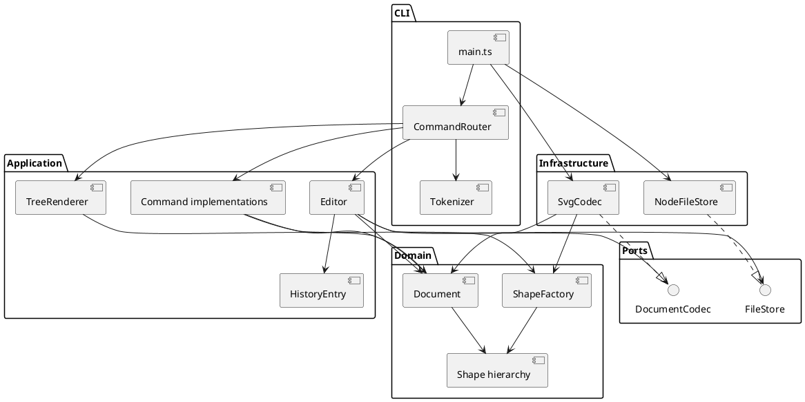

# SVG 编辑器项目文档

版本说明：本文件对应 Phase 1 最终交付，包含全部生产模块、自动化测试、示例与验收记录；沿用前面三次交付历史，最终提交以 final 标签标记。修订日期：2026-10-26。

项目范围为 Lab1 Phase 1：TypeScript 面向对象 CLI SVG 编辑器。内置 rect/circle/ellipse/line/text/g；box、动态 ShapeProvider 加载及 VS Code 扩展宿主不在本阶段实现范围内。

## 架构方案

### 1. 模块划分与职责

| 模块 | 职责 | 代表类 |
|---|---|---|
| src/domain | 图形数据与行为、唯一 ID、树结构、不变量 | Shape、Rect、Circle、Ellipse、Line、Text、Group、Document、ShapeFactory、Numbers |
| src/application | 用例、事务边界、撤销重做和显示 | Editor、HistoryEntry、Command、TreeRenderer、commands/*Command |
| src/ports | 文件与 SVG 编解码接口 | FileStore、DocumentCodec（接口） |
| src/infrastructure | Node 文件系统与 XML 适配 | NodeFileStore、SvgCodec |
| src/cli | 参数分词、命令注册、终端装配 | Tokenizer、CommandRouter；main.ts 为装配入口 |
| test | 行为验收、真实进程/文件测试、架构约束 | editor、integration、architecture 测试，MemoryFileStore |
| examples | 可回放命令及生成的 SVG | flowchart.commands、flowchart.svg |

#### 组件图（PlantUML）



### 2. 设计模式的选择

#### Command（必选）

每个编辑操作都有实现 `Command.execute(Document): string` 的类：CreateCommand、DeleteCommand、MoveCommand、ScaleCommand、SetCommand、GroupCommand、UngroupCommand、AddToCommand 和 OrderCommand（front/back 共用）。Router 仅解析参数和构造命令，Editor 统一调度事务与历史。图形编辑逻辑不放在 REPL 中。

#### Composite

Shape 是统一抽象。叶子各自实现 clone，Group 管理私有子列表并递归 move/scale。外部拿到的 children 是副本，不能直接增删内部列表。命令对 g/叶子的 move、scale、set、delete 使用相同接口；仅组装/解散所需的容器检查使用类型判断。g 的展示属性遵循 SVG 继承，不强制覆写有独立颜色的子图形。

#### Memento

HistoryEntry 保存编辑前后的深拷贝，并在 undo/redo 时再次克隆。Editor 在副本文档上执行命令，全部成功后才替换当前状态、压栈并清空 redo。这样多图形 group 和递归 scale 均为一个原子单元，数值溢出等中途失败不会改动当前文档。

代价是每条历史占 O(n) 空间、编辑需 O(n) 拷贝，适合本阶段小型文档；不提前实现复杂的逆操作日志。文档类成功操作建立历史屏障，失败操作不影响历史。

#### Factory 与 Adapter

ShapeFactory 把类型名映射为构造函数及创建参数 schema，避免每个操作重复 switch(tag)。NodeFileStore 与 SvgCodec 通过 ports 接入；测试使用 MemoryFileStore，核心业务不依赖磁盘或 XML 库。

**两处名字分派及待重构项**：CommandRouter 的命令注册表；ShapeFactory 的类型注册表。两者目前均为静态内置注册，下一阶段要改为由装配层注入可注册 provider。SVG 变换解析的 translate/scale 是格式语法解析，不用于图形类型或编辑命令分派。

### 3. 依赖方向规则

| 所在模块 | 允许依赖 | 理由 |
|---|---|---|
| domain | domain | 图形与树结构规则独立于交互方式、文件格式和运行时 IO，便于复用和单独验证 |
| ports | ports、domain | 用领域 Document 定义存储/编解码协议，不绑定具体实现 |
| application | application、domain、ports | 用例操作领域对象，通过接口请求 IO，避免依赖终端或具体磁盘实现 |
| infrastructure | infrastructure、ports、domain | 实现端口，允许依赖 Node 文件系统及第三方 XML 库，但不能反向调用业务调度 |
| cli | cli、application、domain、infrastructure | main.ts 是装配入口，需要选择具体适配器；Router 使用领域 Numbers 校验数字 |
| test | 可跨生产模块 | 验证完整行为；生产模块不得反向依赖测试代码 |

以上规则也允许同模块内部引用。domain、ports、application 不得引入外部运行时库。任何违反规则的 import 都应作为待处理项记录，不能通过默默放宽规则使检查通过。

生产代码的两处名字分派是 CommandRouter 和 ShapeFactory 的静态注册表，按需求列为后续插件化待重构项。它们是当前架构明确允许的集中分派，不是依赖方向违规。


### 4. 变化点假设

| 变化点 | 当前预留或决定 |
|---|---|
| 增加图形和 box | Shape 多态 + Factory 集中创建；未来用 provider 注入注册。尚未宣称实现“内核零修改”的插件化目标 |
| 增加 GUI/agent 输入 | 用例和 Command 不依赖 CLI，可新增输入适配器 |
| 修改存储位置/格式 | FileStore、DocumentCodec 可替换，Editor 无需直接接触 fs/XML |
| 超大文档/长历史 | 当前克隆、遍历为线性成本；以后可增加 ID 索引及差量历史，目前优先原子性和可验证性 |
| 完整 SVG 标准 | 本阶段采用显式受支持子集；拒绝未知结构，避免无声删内容。将来引入更完整 SVG adapter |
| 对齐输出格式 | 摘要由 Shape 多态定义，完整属性由 details 输出；Renderer 处理树形连接线 |

补充取舍：本阶段不实现多文档标签页、自动保存或完整 SVG 浏览器渲染器，原因是需求以单文档 CLI 为边界。用户提出的“如何知道当前 SVG”已记录为交互改进点；Editor 已保存路径，但尚未提供 status 命令，也没有未保存状态提示。本次不把讨论中的建议描述为已实现功能。


## 过程记录


1. 阅读需求后确认 Phase 1 与后续 box 的边界，在空目录建立独立 Git 仓库并提交初始架构。
2. 先实现封装领域对象，再加入 Command、快照事务、端口、XML 适配和 REPL，分步提交。
3. 首次编译及脚本验证通过创建、组移动、undo/redo、中文文本转义和保存再读取。
4. 验收测试首次出现一处失败：测试同时用了重复 ID 和不存在的父容器，却只期待父容器错误。检查实现后将该用例改为新 ID，单独验证缺失容器；没有为了测试修改错误优先级。
5. 检查发现虚拟根 ID 不应占用用户 ID 命名空间；将 Group 的循环检测从 ID 比较改为对象身份遍历，增加同名回归用例。
6. 检查导入变换发现仅缩放几何会遗漏文字大小与描边，补充继承解析及嵌套缩放测试。CLI scale 语义保持原要求。
7. 测试运行器的直接 tsx 命令在当前环境无法创建 IPC socket；改用 `node --import tsx`，避免额外 IPC，项目启动脚本一并调整。
8. 完成源码格式化、依赖方向扫描、端到端脚本测试和可回放流程图示例。

### 用户反馈与阶段交付

| 时间/阶段 | 实际问题或反馈 | 判断与处理 | 状态 |
|---|---|---|---|
| 2026-10-21 初次开发 | 需求包含 box 的详细示例，但明确标注为后续阶段 | 按阶段边界只实现六种内置类型，create box 保持错误反馈 | 已落实 |
| 初次演示后 | 用户询问当前操作的是哪个 SVG | 确认现有程序是单文档内存模型、仅保存时写磁盘；识别出缺少当前文件状态展示 | 已解释；status 尚未实现 |
| 第一次远程交付 | 用户要求分步上传 | 保留完整本地实现，另用 submission-stage 基于远程初始 README 分阶段提交 | 第一部分 bb26fd5 已上传 |
| 2026-10-22 第二次交付 | 用户要求约 50%，不包含 final | 上传领域模型及编辑流程/端口，在 README 中明确尚不可运行完整 CLI | f624f63、895d496 已上传 |
| 2026-10-26 第三次交付 | 用户要求约 75% | 加入 CLI、SVG IO、依赖锁文件，验证可安装、可运行及磁盘往返 | 5f324d7 已上传；完整测试、示例及最终验收留待最后阶段 |
| 2026-10-26 文档核对 | 用户重新提供文档四部分要求 | 按指定章节整理，补上各依赖规则的理由，纠正旧文档“未配置远程”的过时描述 | 当时仅本地修订；现合入最终版本 |
| 2026-10-26 最终交付 | 用户授权提交最终版本并打 final 标签 | 合入完整测试、示例、启动脚本和四部分文档；最终提交前执行完整检查 | 最终版本交付范围已补齐 |

这里的百分比仅表示与用户约定的交付阶段，不是精确的代码比例或覆盖率。完整实现曾先在本地形成，随后按用户要求分批发布；不将分批推送描述为代码在不同日期才首次写成，也不改写提交日期。

### 修订记录

- 将初始五模块方案细化到实际类和目录，增加 application/commands 子目录、Numbers 数值校验及 HistoryEntry 快照对象；均为原模块内部细化，没有改变依赖方向。
- 原简略方案没有画出装配入口对 infrastructure 的引用；现图与规则明确 main.ts 装配具体适配器，补充 CLI 对 Numbers 的合法依赖。
- 初稿仅有架构草案和阶段追加记录；本次统一为“架构方案、过程记录、一致性自查、质量保证手段”四部分。
- 保留 SVG 受支持子集和显示格式差异说明，不用“全部 SVG 标准已支持”替代真实边界。


## 一致性自查

### 1. 模块划分是否一致

**结论：五个生产模块与方案一致。** 实际目录为 src/domain、src/application、src/ports、src/infrastructure、src/cli。application/commands 是应用层内部子目录，Numbers 和 HistoryEntry 也是内部细化，已在修订记录中说明。

main.ts 是装配与 REPL 入口，不定义类；其余生产类采用一类一文件，文件名对应类名。ports 和 Command 定义接口。最终版本已加入 test 与 examples。此前 75% 版本暂未包含它们，这是过程记录中已说明的分阶段交付差异；最终目录与方案一致。

### 2. 依赖方向是否一致

**结论：当前源码抽样与本地架构检查未发现违反规则的 import。** 可按以下文件复核：

| 抽样文件 | 实际依赖 | 对照结果 |
|---|---|---|
| src/domain/Shape.ts | 同层 Numbers | 不接触应用、磁盘或终端，符合规则 |
| src/domain/Document.ts | 同层 Shape、Group、Numbers | 领域层内部依赖，符合规则 |
| src/application/Editor.ts | Document、Numbers、FileStore、DocumentCodec、Command、HistoryEntry | 通过端口使用 IO，未直接依赖 fs 或 SvgCodec，符合规则 |
| src/ports/DocumentCodec.ts | 领域 Document | 协议以领域对象为边界，符合规则 |
| src/infrastructure/NodeFileStore.ts | FileStore、Node fs/path/crypto | IO 限于外层适配器，符合规则 |
| src/infrastructure/SvgCodec.ts | DocumentCodec、领域类型、XML 库 | 具体编解码适配，符合规则 |
| src/cli/main.ts | Editor、CommandRouter、具体 IO 适配器、Node readline | 装配入口符合允许方向 |

本版本的 test/architecture.test.ts 扫描静态 import、内层外部依赖及导出类/文件命名。它是轻量正则扫描，不是全程序依赖证明，也不保证未来动态 import 自动被覆盖。该测试已纳入本版本的 npm run check。

### 待处理项与已知限制

目前没有已发现且未处理的跨层 import 违规。后续事项包括静态命令/图形注册表的插件化、快照历史的性能优化和当前文档状态展示；这些是明确记录的变化点，并非已经完成。

- 同父级 group 占据首个被选元素位置；跨父级 group 追加根。选中成员按原文档先序排列，而非用户参数顺序。此点是对“从各自原父容器摘出，保持相对顺序”的明确化。
- 图形 ID 大小写敏感。外部文件先扫描全部显式 ID，再补缺失 ID，避免补号撞上后出现的元素。
- 根级 g 禁止 ungroup，遵守文档中的特殊约定。
- SVG 正数等比 scale/translate 导入时按从右到左顺序归一化，避免 reparent 时丢失父级变换。嵌套缩放下解析继承的字体和描边宽度。CLI scale 仍仅缩放几何属性。
- `box` 返回 unknown shape type；未知 `data-kind` 的 g 仍按普通 g 使用。
- tree/show/help 不进入历史，canvas 查询不建立屏障；成功的 init/read/save/canvas 修改清空历史。save 指定新路径后记住新路径。
- 支持文件保留形状结构、数值、文本及受支持属性；不承诺保留源 XML 排版、注释或 transform 原写法。
- 拒绝 path、CSS/style、tspan、非等比/旋转/矩阵变换及 DTD。完整支持列表与限制见工程 README。
- undo/redo 使用 `undone:`/`redone:` 加原操作摘要，未逐字复制需求中的演示台词；tree 保留关键几何信息，未填充列宽空格。

## 质量保证手段

### 最终版本验证

2026-10-26 最终验收已通过：严格 TypeScript 编译、49 项自动化测试（49 通过、0 失败）、Prettier 检查及流程图脚本回放。可在此工程目录复现：

```sh
npm install
npm run check
npm run cli < examples/flowchart.commands
```

| 需求面 | 验证方式 |
|---|---|
| 六种图形、in、文本参数、颜色默认值 | 命令级行为测试 |
| Composite move/scale/delete/set | 多层嵌套与数值断言 |
| group/ungroup/addto/front/back | 顺序、父级、循环与回滚断言 |
| undo/redo、分支历史、IO 屏障 | 显示跳过、错误不污染、新编辑清 redo |
| 自动 ID 与重复 ID | 全文预留、嵌套、失败保留旧文档 |
| SVG 往返 | 结构、几何、中文、空格、实体转义、viewBox |
| SVG 变换 | 组合、继承字体/描边、拒绝不支持语法 |
| 输入/文件失败 | 精确错误前缀、原子性、无穷/负值/溢出 |
| 真实 CLI | 子进程脚本运行、保存真实文件、错误后继续、退出码 |
| 架构约束 | import 依赖方向、类与文件命名扫描 |

另外回放 examples/flowchart.commands，生成 8 元素流程图，符合文档版本 A 的节点/文字/连线结构。没有声称测试覆盖所有 SVG 规范，导入子集边界已记录。

### 阶段验证与最终验收的区别

第三阶段的 check 仅包含编译和格式检查，另外通过临时 CLI 子进程验收。最终版本已经合入完整 test、examples 和检查脚本，npm run check 会执行完整 49 项测试；此前阶段记录保留为历史，不作为最终测试的替代。

### 验证依据与局限

采用“需求命令清单 → 对应行为断言 → 实际 CLI 文件往返”建立证据：不仅检查是否抛异常，也检查父级、顺序、坐标、颜色、文本和历史状态。对组合修改检查一次撤销能否完整恢复；对失败检查文档和 redo 栈是否保持不变。

SVG 往返测试证明受支持结构和属性可保留，不证明所有 SVG 特性均可导入，也不替代跨浏览器像素级视觉回归。当前没有量化代码覆盖率报告或大规模性能基准，不声称 100% 覆盖。

最终交付以分阶段提交分支为基础，纳入完整测试、流程图示例和修订后的文档，保留真实开发与发布过程。发布使用 main 分支及指向其最终提交的 final 标签；不把早期本地完整实现的旧标签作为本次最终交付。需求未提供截止时间，因此不能据此断言满足截止时间要求。
